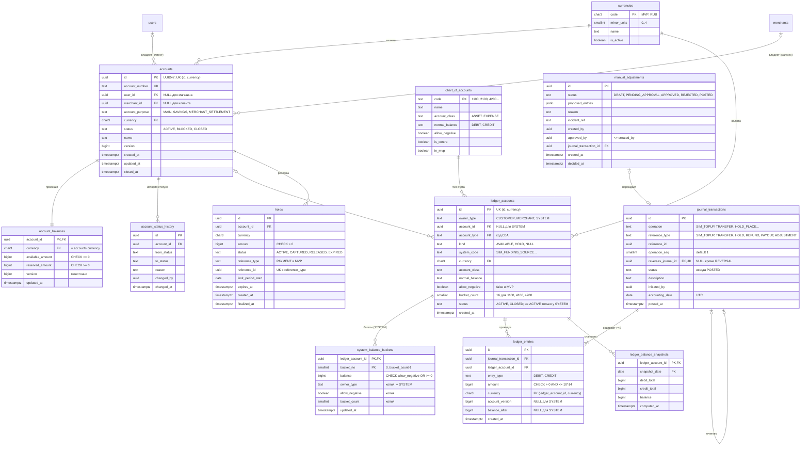
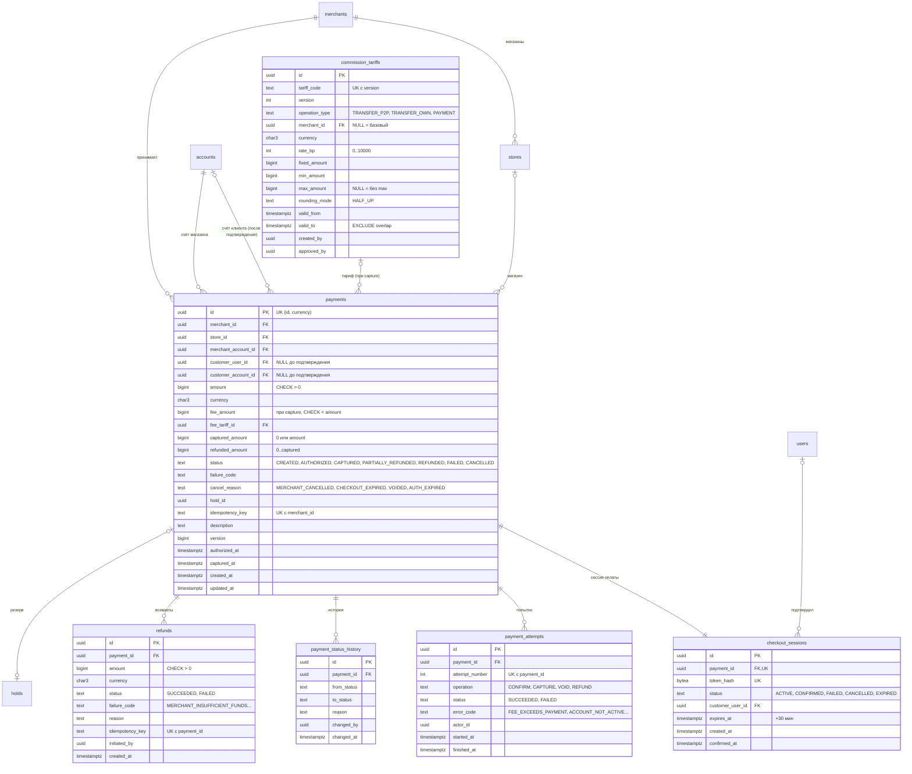
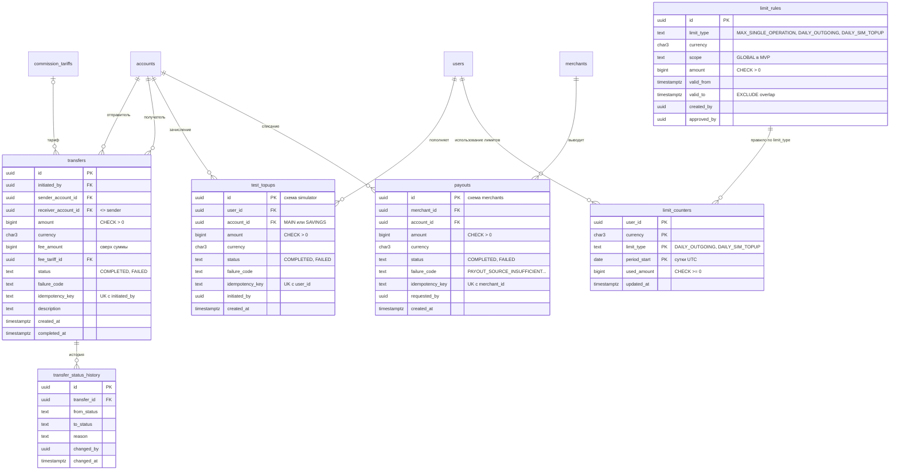
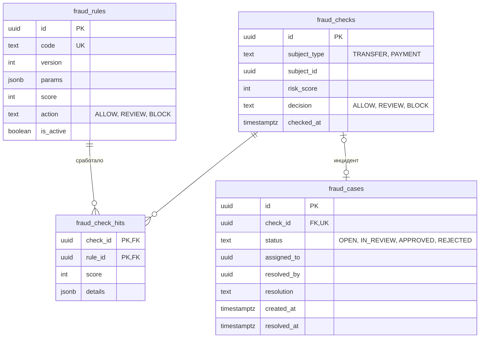
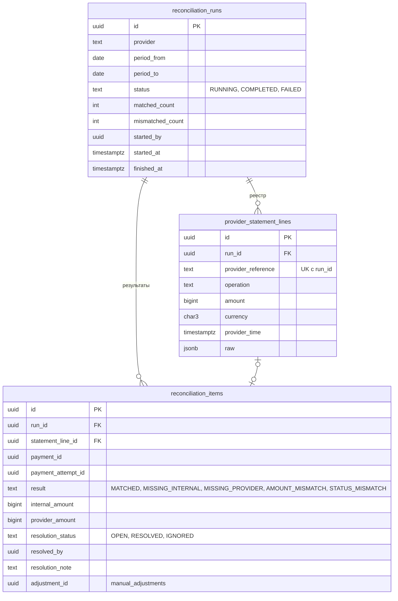

# ER-диаграмма PostgreSQL

Статус: **принято для MVP** (этап 2). Описание полей и типов — в [database-schema.md](database-schema.md), ограничения и индексы — в [data-integrity.md](data-integrity.md), решения — в [../architecture/decisions.md](../architecture/decisions.md).

Диаграмма разбита на части по модулям. Таблицы, которые встречаются в нескольких частях, на последующих диаграммах показаны только ключевыми полями. Обозначения: `PK` — первичный ключ, `FK` — внешний ключ, `UK` — уникальный. Типы упрощены для Mermaid: `char3` = `CHAR(3)`, `text_array` = `TEXT[]`, `text` = `TEXT` с CHECK на перечень значений.

Схемы PostgreSQL по модулям ([D-18](../architecture/decisions.md#d-18)): `auth`, `merchants`, `accounts`, `ledger`, `payments`, `transfers`, `commissions`, `limits`, `simulator`, `notifications`, `audit`, `platform` (idempotency, outbox, inbox). После MVP: `fraud`, `reconciliation`.

Этап 3.3 создаёт `accounts` и `ledger` целиком. `auth.users` в `00002` — заглушка PK ради FK со счетов; этап 3.20 (`00005`) расширяет `auth` (users, roles, sessions, tokens, login_attempts, rate_limit_counters, action_confirmations) без DROP. `merchants.merchants` остаётся заглушкой PK. Go-модуля auth и bootstrap ADMIN нет. Схемы payments/transfers в этой фазе не реализуются. Контракт — [../architecture/identity-auth.md](../architecture/identity-auth.md).

## 1. Финансовое ядро: счета и ledger

`account_restrictions` из этапа 1 перенесена на после MVP: в MVP ограничение операций выражается статусом `BLOCKED` ([D-26](../architecture/decisions.md#d-26)).

## 2. Платежи и checkout

## 3. Переводы, симулятор, выплаты, лимиты

Связь `limit_rules — limit_counters` логическая (по `limit_type` и `currency`), FK нет.

## 4. Идентификация, мерчанты, платформа, аудит

```mermaid
erDiagram
    users ||--o{ user_roles : "роли"
    roles ||--o{ user_roles : ""
    users ||--o{ sessions : "сессии"
    sessions ||--o{ refresh_tokens : "токены (ротация)"
    refresh_tokens |o--o| refresh_tokens : "replaced_by"
    users |o--o{ login_attempts : "попытки"
    users ||--o{ action_confirmations : "подтверждения"
    users |o--o{ rate_limit_counters : "окна лимитов (логически)"
    merchants ||--o{ merchant_members : "участники"
    users ||--o{ merchant_members : ""
    merchants ||--o{ stores : ""
    merchants ||--o{ api_keys : "ключи"
    stores |o--o{ api_keys : ""
    merchants ||--o{ webhook_endpoints : ""
    webhook_endpoints ||--o{ webhook_deliveries : "доставки"
    outbox_events ||--o{ webhook_deliveries : "event_id (логически)"

    users {
        uuid id PK
        text email UK "lower(email)"
        text password_hash "Argon2id"
        text first_name
        text last_name
        text status "ACTIVE, LOCKED, DISABLED"
        timestamptz created_at
        timestamptz updated_at
    }
    roles {
        text code PK "CUSTOMER..ADMIN"
        text description
    }
    user_roles {
        uuid user_id PK, FK
        text role_code PK, FK
        uuid granted_by
        timestamptz granted_at
    }
    sessions {
        uuid id PK
        uuid user_id FK
        text user_agent
        inet ip
        timestamptz created_at
        timestamptz last_seen_at
        timestamptz revoked_at
    }
    refresh_tokens {
        uuid id PK
        uuid session_id FK
        bytea token_hash UK
        uuid replaced_by FK
        timestamptz expires_at
        timestamptz used_at
        timestamptz revoked_at
    }
    login_attempts {
        uuid id PK
        text email
        uuid user_id FK
        inet ip
        boolean success
        text failure_reason
        timestamptz attempted_at
    }
    action_confirmations {
        uuid id PK
        uuid user_id FK
        text action_type
        bytea code_hash
        int attempts_left
        timestamptz expires_at
        timestamptz confirmed_at
    }
    rate_limit_counters {
        text bucket PK "LOGIN_EMAIL, LOGIN_IP, REGISTER_IP, REFRESH_IP"
        text counter_key PK
        timestamptz window_start PK "15 мин UTC"
        int count "CHECK >= 0"
        timestamptz updated_at
    }
    merchants {
        uuid id PK
        text legal_name
        text display_name
        text status "PENDING, ACTIVE, SUSPENDED"
        timestamptz created_at
    }
    merchant_members {
        uuid merchant_id PK, FK
        uuid user_id PK, FK
        text member_role "OWNER, DEVELOPER, VIEWER"
    }
    stores {
        uuid id PK
        uuid merchant_id FK
        text name
        text url
        text status
    }
    api_keys {
        uuid id PK
        uuid merchant_id FK
        uuid store_id FK
        text key_prefix UK
        bytea key_hash
        text mode "TEST в MVP"
        text_array scopes
        timestamptz expires_at
        timestamptz revoked_at
    }
    webhook_endpoints {
        uuid id PK
        uuid merchant_id FK
        text url
        bytea secret_encrypted
        text_array event_types
        boolean is_active
    }
    webhook_deliveries {
        uuid id PK
        uuid endpoint_id FK
        uuid event_id "outbox_events.id"
        int attempt
        text status "PENDING, DELIVERED, DEAD"
        int response_code
        text last_error
        timestamptz next_attempt_at
        timestamptz processing_until "lease"
        text lease_owner
        timestamptz delivered_at
    }
    idempotency_keys {
        uuid id PK
        text scope "user:id / merchant:id"
        text endpoint "UK с scope, key"
        text key
        bytea request_hash "SHA-256"
        text status "IN_PROGRESS, COMPLETED"
        smallint response_code
        jsonb response_body
        text resource_type
        uuid resource_id
        timestamptz created_at
        timestamptz completed_at
        timestamptz expires_at "+24 ч"
    }
    outbox_events {
        uuid id PK "event_id"
        bigint seq UK "identity, порядок"
        text aggregate_type
        uuid aggregate_id "ключ порядка"
        bigint aggregate_version
        text event_type "payment.captured"
        smallint event_version
        jsonb payload
        jsonb headers "trace_id"
        text status "PENDING, PUBLISHED, DEAD"
        int attempts
        timestamptz next_attempt_at
        timestamptz processing_until "lease"
        text lease_owner
        text last_error
        timestamptz created_at
        timestamptz published_at
    }
    inbox_messages {
        text consumer PK
        uuid message_id PK
        timestamptz received_at
        timestamptz processed_at
    }
    audit_logs {
        uuid id PK
        bigint seq UK "порядок"
        uuid actor_id
        text actor_type "USER, STAFF, SYSTEM, API_KEY"
        text action "ACCOUNT_BLOCKED, TARIFF_CHANGED..."
        text resource_type
        uuid resource_id
        jsonb before_state
        jsonb after_state
        inet ip
        text request_id
        bytea prev_hash "если Q-20"
        bytea hash
        timestamptz occurred_at
    }
    notifications {
        uuid id PK
        uuid user_id
        text channel "EMAIL, IN_APP"
        text template
        jsonb payload
        text status
        timestamptz created_at
        timestamptz read_at
    }
```

Таблицы `idempotency_keys`, `outbox_events`, `inbox_messages` (схема `platform`), `audit_logs` и `notifications` не имеют FK на бизнес-таблицы: связи показаны в [§7](#7-межмодульные-связи).

## 5. После MVP: fraud и сверка

Схемы `fraud` и `reconciliation` в MVP не создаются ([D-20](../architecture/decisions.md#d-20)): нет внешнего провайдера, сверять не с чем, а антифрод в MVP сводится к лимитам ([D-24](../architecture/decisions.md#d-24)). Модель этапа 1 сохранена как задел. Сверка внутренних данных (ledger против проекций) в MVP есть, но это фоновая проверка без собственных таблиц.

### 5.1. Fraud

Вместе с fraud вернутся `transfers.hold_id`, статусы `ON_HOLD`/`CANCELLED` у переводов и `holds.reference_type = 'TRANSFER'` ([D-05](../architecture/decisions.md#d-05)).

### 5.2. Сверка с внешним провайдером

Вместе со сверкой вернутся `payment_attempts.provider_reference` и статусы `STARTED`/`UNKNOWN`.

## 6. Изменения относительно этапа 1

| Было | Стало | Решение |
|---|---|---|
| Проекция только у пользовательских счетов | `system_balance_buckets` для системных счетов | [D-02](../architecture/decisions.md#d-02) |
| Тип счёта — свободный текст | Справочник `chart_of_accounts` | [D-03](../architecture/decisions.md#d-03) |
| `topups` | `simulator.test_topups` | [D-15](../architecture/decisions.md#d-15) |
| `payouts`: `INITIATED, SENT, SETTLED, FAILED`, `bank_reference` | `COMPLETED, FAILED`, без банка | [D-25](../architecture/decisions.md#d-25) |
| Платёж без сессии оплаты | `checkout_sessions` | [D-22](../architecture/decisions.md#d-22) |
| Статус платежа `PENDING` | Нет в MVP | [D-21](../architecture/decisions.md#d-21) |
| `refunds.fee_refund_amount`, `payments.refunded_fee_amount` | Удалены: комиссия не возвращается | [D-09](../architecture/decisions.md#d-09) |
| `transfers.ON_HOLD`, `hold_id` | После MVP | [D-05](../architecture/decisions.md#d-05) |
| Лимитов в схеме нет | `limit_rules`, `limit_counters`, `holds.limit_period_start` | [D-24](../architecture/decisions.md#d-24) |
| `idempotency_keys.locked_until` | Статусы `IN_PROGRESS`/`COMPLETED`, блокировка на уникальном индексе, `completed_at` | [D-07](../architecture/decisions.md#d-07) |
| `outbox_events.published_at` как единственный признак | `seq`, `status`, lease (`processing_until`, `lease_owner`), backoff | [D-23](../architecture/decisions.md#d-23) |
| Fraud и сверка в MVP | После MVP (§5) | [D-20](../architecture/decisions.md#d-20) |

## 7. Межмодульные связи

Полиморфные ссылки без FK — сознательное решение, рассчитанное на будущее разделение модулей ([D-12](../architecture/decisions.md#d-12)):

| Откуда | Куда | Почему без FK |
|---|---|---|
| `journal_transactions.reference_id` | holds / transfers / refunds / test_topups / payouts / manual_adjustments | Ledger не зависит от бизнес-модулей; целостность — `UNIQUE` и инвариант «у каждой бизнес-операции есть журнал» ([ledger-model.md §12](../architecture/ledger-model.md#12-финансовые-инварианты)) |
| `holds.reference_id` | payments | то же |
| `payments.hold_id` | `ledger.holds` | обратная ссылка на резерв; направление зависимости payments → ledger не фиксируем FK ([D-12](../architecture/decisions.md#d-12)) |
| `outbox_events.aggregate_id` | любой агрегат | инфраструктурная таблица |
| `webhook_deliveries.event_id` | outbox_events | события архивируются раньше доставок |
| `idempotency_keys.resource_id` | созданный объект | ключи удаляются по TTL |
| `audit_logs.resource_id` | любой ресурс | аудит переживает архивирование ресурсов |
| `limit_counters.limit_type` | limit_rules | правила версионируются по периодам |

FK внутри монолита, которые **разрешены** и будут заменены при выделении модуля: `ledger_accounts.account_id → accounts`, `account_balances.account_id → accounts`, `holds.account_id → accounts`, `payments.*_account_id → accounts`, `transfers.*_account_id → accounts`, `test_topups.account_id → accounts`, `payouts.account_id → accounts`, `accounts.user_id → users`, `accounts.merchant_id → merchants`.
