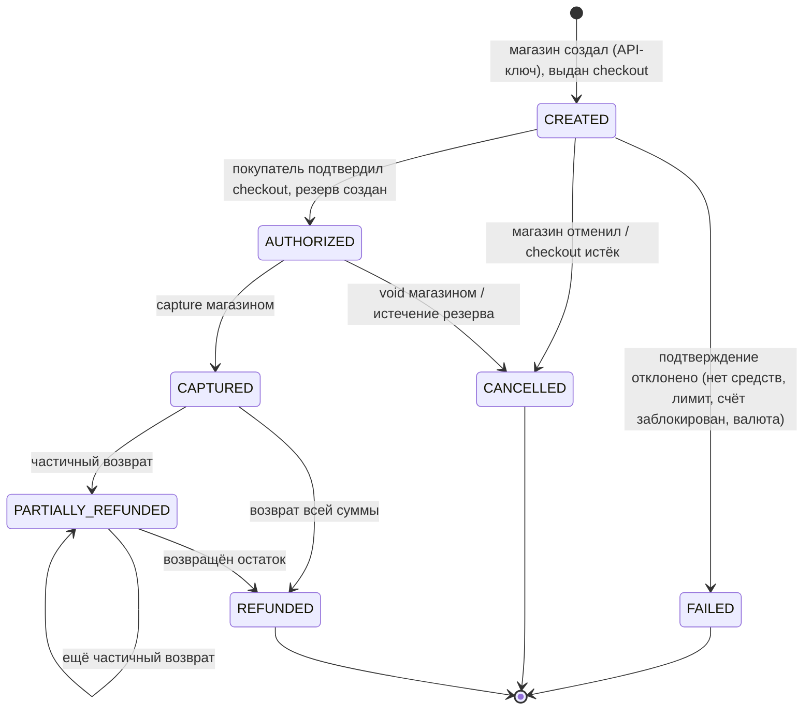
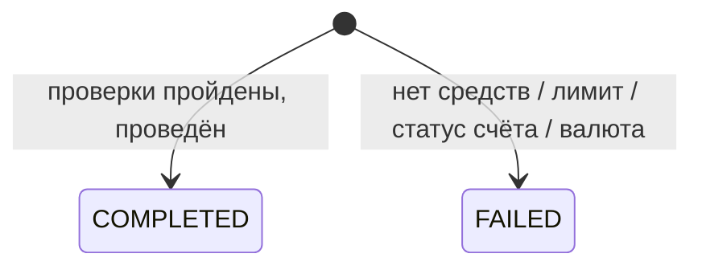
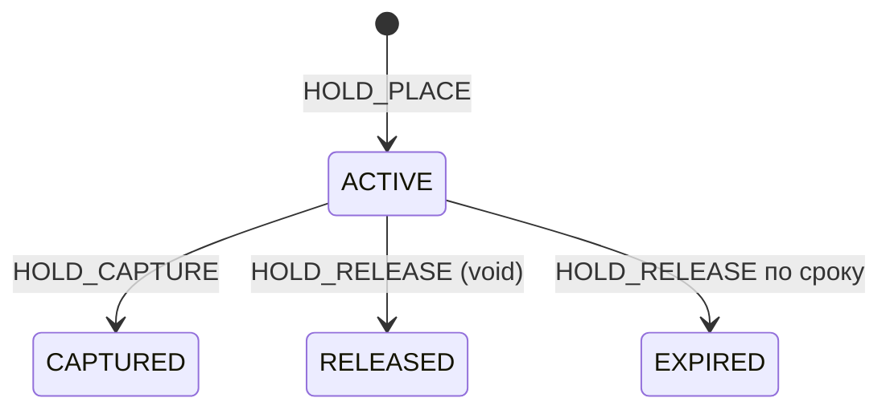

# Движение денег: проводки по шагам

Статус: **принято для MVP** (этап 2). Счета — [chart-of-accounts.md](chart-of-accounts.md), правила — [ledger-model.md](ledger-model.md), решения — [decisions.md](decisions.md). Транзакционные шаблоны и блокировки — [../database/concurrency.md](../database/concurrency.md).

## 1. Обозначения и общие правила

- Суммы указаны в **копейках** (RUB, `minor_units = 2`), в скобках — рубли.
- `Дт X / Кт Y N` — дебет X, кредит Y на сумму N.
- Участники:
  - **A1** — счёт Ивана, RUB (`A1:2100` доступно, `A1:2110` резерв);
  - **A1s** — второй счёт Ивана;
  - **A2** — счёт Марии;
  - **MA** — счёт магазина «Shop» (`MA:2200`);
  - системные — `1100:RUB`, `4100:RUB`, `4200:RUB`.
- Тарифы (ТЗ §2.7):
  - переводы другому клиенту — 50 bp;
  - переводы между своими счетами — 0;
  - платежи — 150 bp;
  - для всех: min 1 000 (10 ₽), max 50 000 (500 ₽), `HALF_UP`.
- **«ТХ» — одна транзакция PostgreSQL.** В неё входят ключ идемпотентности, бизнес-объект, вызов `ledger.post_journal` (журнал, проводки, проекции, резерв), история статусов и outbox-событие.
- **Неуспешная операция не создаёт проводок.** Отказ сохраняется как объект `FAILED` с кодом причины ([D-19](decisions.md#d-19)). Исключение — освобождение уже созданного резерва.

## 2. Машины состояний (MVP)

### 2.1. Платёж

Решения [D-21](decisions.md#d-21), [D-22](decisions.md#d-22), [D-32](decisions.md#d-32).

Соответствие базовому циклу этапа 2:

| Требуемый переход | В MVP | Пояснение |
|---|---|---|
| CREATED → PENDING → AUTHORIZED | CREATED → AUTHORIZED | Подтверждение checkout — одна транзакция. `PENDING` в ней никому не виден, поэтому не хранится |
| PENDING → FAILED | CREATED → FAILED | То же |
| AUTHORIZED → CANCELLED | есть | void магазином, `cancel_reason = VOIDED` |
| AUTHORIZED → CANCELLED (истечение резерва) | есть | scheduler, `cancel_reason = AUTH_EXPIRED`, резерв → `EXPIRED` |
| CAPTURED → PARTIALLY_REFUNDED / REFUNDED | есть | |
| PARTIALLY_REFUNDED → PARTIALLY_REFUNDED / REFUNDED | есть | |
| *(добавлено)* CREATED → CANCELLED | есть | Магазин отменил до оплаты или checkout истёк (`CHECKOUT_EXPIRED`). Без этого перехода неоплаченные платежи висели бы бесконечно |

`PENDING` вводится миграцией, когда появится асинхронный шаг: fraud `REVIEW` или внешний провайдер (§12).

Запрещено (ТЗ §2.4): возврат из `CREATED`, `AUTHORIZED`, `FAILED`, `CANCELLED`; capture не из `AUTHORIZED`; void после capture (возможен только возврат); повторное подтверждение checkout.

### 2.2. Перевод

Перевод проводится синхронно. Отмены в MVP нет ([D-05](decisions.md#d-05)). Путь с резервом `ON_HOLD` для fraud `REVIEW` описан в §12.

### 2.3. Резерв

### 2.4. Возврат и выплата

Возврат: `SUCCEEDED` или `FAILED`, финальный статус сразу. Выплата: `COMPLETED` или `FAILED` ([D-25](decisions.md#d-25)). Промежуточного `PENDING` в MVP нет (провайдера нет).

---

## 3. Симулятор: источник и сток виртуальных денег

Решение [D-15](decisions.md#d-15).

**Отделение симуляции от «банковских» операций:**

- Модуль `simulator` — единственный, кто создаёт `SIM_TOPUP`. Он включается флагом конфигурации и в UI помечен «тестовые деньги».
- В ledger симуляция видна только как системный счёт **1100 «Внешний источник виртуальных средств (симулятор)»** и код операции с префиксом `SIM_`. Ledger, платежи, переводы и возвраты не знают о симуляции и работают одинаково для «любых» денег.
- Выплата магазину выводит деньги обратно во «внешний мир» симулятора: Кт 1100.
- Тестовое пополнение доступно клиенту из UI и администратору. Есть суточный лимит пополнения ([D-24](decisions.md#d-24), значение — [Q-12](open-questions.md#q-12)). Пополнения счетов магазинов нет: деньги магазина появляются только из продаж.

**Иван получает 10 000 ₽ тестовых денег.** ТХ: объект `simulator.test_topups` (`COMPLETED`), операция `SIM_TOPUP`.

| Счёт | Дебет | Кредит |
|---|---|---|
| 1100:RUB Источник виртуальных средств | 1 000 000 | |
| A1:2100 Иван доступно | | 1 000 000 |
| **Итого** | **1 000 000** | **1 000 000** |

A1: available = 1 000 000. 1100 увеличивается, это запись в один бакет.

---

## 4. Переводы

Проверки в одной ТХ, под блокировками ([concurrency.md §5.1](../database/concurrency.md#51-перевод)):

1. Идемпотентность.
2. Счёт отправителя принадлежит инициатору (ТЗ §5).
3. Оба счёта `ACTIVE` ([D-26](decisions.md#d-26)).
4. Валюты совпадают.
5. `sender ≠ receiver`, `0 < amount ≤ MAX`.
6. Лимит на одну операцию и суточный лимит (для перевода другому клиенту).
7. Комиссия.
8. `available ≥ amount + fee`.

### 4.1. Между своими счетами

**Иван: 1 000 ₽ с A1 на A1s**, комиссия 0. `TRANSFER`:

| Счёт | Дебет | Кредит |
|---|---|---|
| A1:2100 | 100 000 | |
| A1s:2100 | | 100 000 |
| **Итого** | **100 000** | **100 000** |

### 4.2. Другому клиенту, с комиссией

**Иван → Мария 1 000 ₽.** 0,5 % = 500 коп., меньше min, поэтому комиссия **1 000 (10 ₽)**. Её платит отправитель сверх суммы ([D-27](decisions.md#d-27)). `TRANSFER`:

| Счёт | Дебет | Кредит |
|---|---|---|
| A1:2100 Иван | 101 000 | |
| A2:2100 Мария | | 100 000 |
| 4100:RUB Доход переводы | | 1 000 |
| **Итого** | **101 000** | **101 000** |

Перевод `COMPLETED`, `fee_amount = 1 000`, `fee_tariff_id`. Outbox: `transfer.completed`.

### 4.3. Неуспешные переводы

Проводок нет, перевод `FAILED` с `failure_code`, HTTP `422`.

| Ситуация | failure_code |
|---|---|
| Остаток меньше `amount + fee` | `INSUFFICIENT_FUNDS` |
| Два параллельных перевода по 8 000 ₽ при 10 000 ₽ (ТЗ §2.5) | второй — `INSUFFICIENT_FUNDS` ([S-01](../database/concurrency.md#9-каталог-конкурентных-сценариев)) |
| Счёт отправителя или получателя `BLOCKED` / `CLOSED` | `ACCOUNT_NOT_ACTIVE` |
| Разные валюты | `CURRENCY_MISMATCH` |
| Превышен лимит | `LIMIT_EXCEEDED` |

Ошибки формата (неверный JSON, неизвестный получатель, отрицательная сумма) → `400`/`404`, перевод не сохраняется.

---

## 5. Платёж: checkout → авторизация → capture

**Иван покупает в Shop на 5 000 ₽ (500 000).**

**Шаг 1 — создание** (магазин, API-ключ, `Idempotency-Key`). ТХ: `payments` (`CREATED`, без счёта покупателя), `checkout_sessions` (хеш одноразового токена, `expires_at = now + 30 мин`), outbox `payment.created`. Ответ содержит `checkout_url`. **Проводок нет.** Проверка: по действующему тарифу `fee < amount`, иначе `AMOUNT_TOO_SMALL`.

**Шаг 2 — подтверждение checkout** (Иван, своим токеном, выбирает A1). ТХ:

- блокировка платежа (`CREATED`, checkout не истёк);
- проверки: A1 принадлежит Ивану, `ACTIVE`, валюта = валюта платежа; лимиты; `available ≥ 500 000`;
- `HOLD_PLACE`; платёж → `AUTHORIZED`, `customer_account_id = A1`; резерв `ACTIVE`, `expires_at = now + 7 суток`; checkout → `CONFIRMED`.

| Счёт | Дебет | Кредит |
|---|---|---|
| A1:2100 Иван доступно | 500 000 | |
| A1:2110 Иван резерв | | 500 000 |

A1: available 500 000, reserved 500 000 — ровно картинка ТЗ §2.2 «доступно / зарезервировано».

При отказе (нет средств, лимит, статус) проводок нет: платёж `CREATED → FAILED`, checkout → `FAILED`, попытка записана в `payment_attempts`. Магазин создаёт новый платёж ([D-22](decisions.md#d-22)).

**Шаг 3 — capture** (магазин). ТХ: комиссия по тарифу на момент capture: 1,5 % = **7 500 (75 ₽)** ([D-08](decisions.md#d-08)). `HOLD_CAPTURE`: резерв → `CAPTURED`, платёж → `CAPTURED`, `captured_amount = 500 000`, `fee_amount = 7 500`.

| Счёт | Дебет | Кредит |
|---|---|---|
| A1:2110 Иван резерв | 500 000 | |
| MA:2200 Магазин доступно | | 492 500 |
| 4200:RUB Доход платежи | | 7 500 |
| **Итого** | **500 000** | **500 000** |

Изменения: A1 reserved 500 000 → 0; MA available +492 500; 4200 +7 500. Сумма изменений обязательств и дохода = −500 000 + 492 500 + 7 500 = 0 ✓.

## 6. Отмена и истечение

| Случай | Кто | Проводки | Статусы |
|---|---|---|---|
| Отмена до оплаты | магазин | нет | платёж `CREATED → CANCELLED (MERCHANT_CANCELLED)`, checkout → `CANCELLED` |
| Checkout истёк | scheduler | нет | `CREATED → CANCELLED (CHECKOUT_EXPIRED)` |
| Void | магазин, `POST /payments/{id}/cancel` | `HOLD_RELEASE`: Дт A1:2110 / Кт A1:2100 500 000 | `AUTHORIZED → CANCELLED (VOIDED)`, резерв → `RELEASED` |
| Истечение резерва | scheduler | `HOLD_RELEASE`: Дт A1:2110 / Кт A1:2100 500 000 | `AUTHORIZED → CANCELLED (AUTH_EXPIRED)`, резерв → `EXPIRED` |
| Capture после истечения | магазин | нет | `409 AUTH_EXPIRED` |
| Повторный capture | магазин | нет | идемпотентный ответ (тот же ключ) или `409 INVALID_STATE` |

Void и истечение возвращают использованный суточный лимит, если период тот же ([D-24](decisions.md#d-24)). Гонки capture × void × истечение — [S-04, S-05](../database/concurrency.md#9-каталог-конкурентных-сценариев).

## 7. Возвраты

Модель MVP ([D-08](decisions.md#d-08), [D-09](decisions.md#d-09), [D-10](decisions.md#d-10)):

1. Возврат разрешён из `CAPTURED` и `PARTIALLY_REFUNDED`.
2. Под блокировкой платежа: `refunded_amount + amount ≤ captured_amount`. Иначе `FAILED (REFUND_EXCEEDS_CAPTURED)`, `422`.
3. **Покупатель получает ровно сумму возврата.** Полный возврат = полная сумма платежа.
4. **Комиссия не возвращается.** 4200 при возврате не меняется.
5. **Нужен достаточный доступный остаток магазина:** `MA.available ≥ amount`. Иначе возврат **не проводится**: `refunds.status = FAILED`, `failure_code = MERCHANT_INSUFFICIENT_FUNDS`, HTTP `422`. Платёж не меняется, проводок нет. Магазин может повторить возврат **с новым** `Idempotency-Key`, когда остаток появится.
6. Деньги возвращаются на исходный счёт покупателя, даже если он `BLOCKED` ([D-26](decisions.md#d-26)). Если счёт `CLOSED`: закрытие невозможно при ненулевом остатке, но счёт могли закрыть с нулевым остатком уже после оплаты. В MVP такой возврат отклоняется: `FAILED (ACCOUNT_NOT_ACTIVE)`, `422`. Окончательная политика — открытый вопрос [Q-13](open-questions.md#q-13).
7. Каждый возврат — строка `refunds` со своим id; журнал `REFUND`, `reference_id = refund.id`.

### 7.1. Полный возврат (у магазина достаточно средств)

Исходно у MA есть 100 000 (1 000 ₽) от прошлых продаж. Платёж 5 000 ₽ подтверждён (§5): MA = 100 000 + 492 500 = **592 500**, 4200 = 7 500.

**Возврат 5 000 ₽.** Проверки: 0 + 500 000 ≤ 500 000 ✓; MA 592 500 ≥ 500 000 ✓. `REFUND`:

| Счёт | Дебет | Кредит |
|---|---|---|
| MA:2200 Магазин доступно | 500 000 | |
| A1:2100 Иван доступно | | 500 000 |
| **Итого** | **500 000** | **500 000** |

Итог: Иван получил полные 5 000 ₽; MA = 92 500 (магазин потерял комиссию 7 500); 4200 = 7 500 (без изменений); платёж `REFUNDED`.

### 7.2. Частичные возвраты

Тот же платёж, MA = 592 500 после capture.

| Шаг | Проверка суммы | Проверка остатка MA | Проводки | Статус платежа | refunded | MA | 4200 |
|---|---|---|---|---|---|---|---|
| R1 = 200 000 | 200 000 ≤ 500 000 ✓ | 592 500 ≥ 200 000 ✓ | Дт MA / Кт A1 200 000 | PARTIALLY_REFUNDED | 200 000 | 392 500 | 7 500 |
| R2 = 250 000 | 450 000 ≤ 500 000 ✓ | 392 500 ≥ 250 000 ✓ | Дт MA / Кт A1 250 000 | PARTIALLY_REFUNDED | 450 000 | 142 500 | 7 500 |
| R3 = 100 000 | 550 000 > 500 000 ✗ | — | нет; R3 `FAILED (REFUND_EXCEEDS_CAPTURED)` | PARTIALLY_REFUNDED | 450 000 | 142 500 | 7 500 |
| R4 = 50 000 | 500 000 ≤ 500 000 ✓ | 142 500 ≥ 50 000 ✓ | Дт MA / Кт A1 50 000 | REFUNDED | 500 000 | 92 500 | 7 500 |

### 7.3. Недостаточно средств у магазина

У MA нет других поступлений: после capture MA = 492 500.

| Шаг | Проверки | Результат |
|---|---|---|
| Полный возврат 500 000 | сумма ✓; MA 492 500 < 500 000 ✗ | `FAILED (MERCHANT_INSUFFICIENT_FUNDS)`, проводок нет, платёж `CAPTURED`, MA 492 500 |
| Частичный 200 000 | ✓ ✓ | `SUCCEEDED`, MA 292 500, платёж `PARTIALLY_REFUNDED` |
| Остаток 300 000 | сумма ✓; MA 292 500 < 300 000 ✗ | `FAILED (MERCHANT_INSUFFICIENT_FUNDS)` |

Это прямое следствие D-09 + D-10: удержанная комиссия делает «последний» возврат невозможным без новых поступлений. Сквозной пример с последующей продажей — §8.

---

## 8. Сквозной сценарий симулятора

Минимальный сценарий этапа 2 §3.7. Каждая строка — одна ТХ. Остатки после шага, в копейках.

| # | Шаг | Журнал и проводки | 1100 | A1 дост. | A1 рез. | A2 дост. | MA | 4200 |
|---|---|---|---|---|---|---|---|---|
| 0 | Начало | — | 0 | 0 | 0 | 0 | 0 | 0 |
| 1 | Иван получает 10 000 ₽ | `SIM_TOPUP`: Дт 1100 / Кт A1:2100 1 000 000 | 1 000 000 | 1 000 000 | 0 | 0 | 0 | 0 |
| 2 | Мария получает 5 000 ₽ | `SIM_TOPUP`: Дт 1100 / Кт A2:2100 500 000 | 1 500 000 | 1 000 000 | 0 | 500 000 | 0 | 0 |
| 3 | Shop создаёт платёж P1 на 5 000 ₽ | — (CREATED, checkout) | 1 500 000 | 1 000 000 | 0 | 500 000 | 0 | 0 |
| 4 | Иван подтверждает checkout P1 | `HOLD_PLACE`: Дт A1:2100 / Кт A1:2110 500 000 | 1 500 000 | 500 000 | 500 000 | 500 000 | 0 | 0 |
| 5 | Shop: capture P1 (комиссия 7 500) | `HOLD_CAPTURE`: Дт A1:2110 500 000 / Кт MA:2200 492 500 / Кт 4200 7 500 | 1 500 000 | 500 000 | 0 | 500 000 | 492 500 | 7 500 |
| 6 | Возврат R1 2 000 ₽ по P1 | `REFUND`: Дт MA:2200 / Кт A1:2100 200 000 | 1 500 000 | 700 000 | 0 | 500 000 | 292 500 | 7 500 |
| 7 | Возврат R2 3 000 ₽ по P1 | нет — `FAILED (MERCHANT_INSUFFICIENT_FUNDS)`: 292 500 < 300 000 | 1 500 000 | 700 000 | 0 | 500 000 | 292 500 | 7 500 |
| 8 | Мария платит P2 1 000 ₽: checkout + capture (комиссия 1 500) | `HOLD_PLACE` 100 000; `HOLD_CAPTURE`: Дт A2:2110 100 000 / Кт MA 98 500 / Кт 4200 1 500 | 1 500 000 | 700 000 | 0 | 400 000 | 391 000 | 9 000 |
| 9 | Возврат R3 3 000 ₽ по P1 (новый ключ) | `REFUND`: Дт MA / Кт A1:2100 300 000; P1 → `REFUNDED` | 1 500 000 | 1 000 000 | 0 | 400 000 | 91 000 | 9 000 |
| 10 | Выплата Shop 910 ₽ | `PAYOUT`: Дт MA:2200 / Кт 1100 91 000 | 1 409 000 | 1 000 000 | 0 | 400 000 | 0 | 9 000 |

Проверки после каждого шага:

- **Баланс баланса:** 1100 = A1 + A1рез + A2 + MA + 4200. Например, после шага 9: 1 500 000 = 1 000 000 + 0 + 400 000 + 91 000 + 9 000 ✓; после шага 10: 1 409 000 = 1 000 000 + 400 000 + 0 + 9 000 ✓.
- Иван получил назад **полные** 5 000 ₽ (шаги 6 + 9), его итог 1 000 000 = исходному пополнению ✓.
- Экономика магазина: продажа P2 нетто 98 500 − потерянная комиссия P1 7 500 = 91 000 ✓ (выплачено на шаге 10).
- Доход платформы 9 000 = 7 500 (P1, не возвращена) + 1 500 (P2) ✓.

## 9. Выплата магазину

Решение [D-25](decisions.md#d-25). Магазин (OWNER) запрашивает выплату суммы ≤ `MA.available`. ТХ: `payouts` (`COMPLETED`), `PAYOUT`: Дт MA:2200 / Кт 1100 (шаг 10 выше). При нехватке остатка — `FAILED (INSUFFICIENT_FUNDS)`. Уменьшение 1100 блокирует все его бакеты. Операция редкая, поэтому это приемлемо ([chart-of-accounts.md §3](chart-of-accounts.md#3-системные-счета-остаток-контроль-проекция)).

## 10. Исправление ошибок: сторно и корректировка

- **Сторно.** Ошибочное пополнение J (1 000 000 на A2 вместо A1):
  1. `REVERSAL` J: Дт A2:2100 / Кт 1100 1 000 000, `reverses_journal_id = J`. Если на A2 уже нет 1 000 000, функция отклонит сторно (`PC402`), и оператор решает через корректировку.
  2. Правильный `SIM_TOPUP` на A1.
- **Корректировка.** Компенсация клиенту за сбой: заявка `manual_adjustments` (OPERATOR создал, ADMIN утвердил, это разные люди) → `ADJUSTMENT`: Дт 5900 / Кт A1:2100. Каждое действие пишется в `audit_logs` ([D-31](decisions.md#d-31)).

## 11. Сводки

### 11.1. Комиссии

| Операция | Кто платит | Когда рассчитывается и проводится | Счёт дохода |
|---|---|---|---|
| Перевод другому клиенту | Отправитель, сверх суммы | В ТХ перевода, в том же журнале `TRANSFER` | 4100 |
| Перевод между своими счетами | — (тариф 0) | — | — |
| Платёж | Магазин, удержание из суммы | В ТХ capture, в журнале `HOLD_CAPTURE` | 4200 |
| Возврат | Не взимается, комиссия платежа не возвращается | — | — |
| Пополнение, выплата | Не взимается | — | — |

Комиссия **никогда** не проводится отдельным журналом после основной операции.

### 11.2. Сценарии → журналы

| Сценарий | Журналы | Статус объекта |
|---|---|---|
| Тестовое пополнение | SIM_TOPUP | test_topup COMPLETED |
| Перевод | TRANSFER | COMPLETED |
| Перевод отклонён | — | FAILED |
| Платёж создан | — | CREATED |
| Checkout подтверждён | HOLD_PLACE | AUTHORIZED |
| Checkout отклонён | — | FAILED |
| Отмена или истечение до оплаты | — | CANCELLED |
| Capture | HOLD_CAPTURE | CAPTURED |
| Void или истечение резерва | HOLD_RELEASE | CANCELLED |
| Частичный возврат | REFUND | PARTIALLY_REFUNDED |
| Полный или последний возврат | REFUND | REFUNDED |
| Возврат отклонён | — | refund FAILED, платёж без изменений |
| Выплата | PAYOUT | payout COMPLETED |
| Исправление | REVERSAL (+ новый журнал) / ADJUSTMENT | — |

---

## 12. После MVP: внешний провайдер, REVIEW, асинхронные выплаты

Дизайн этапа 1 сохранён для следующих фаз. В MVP он не реализуется ([D-20](decisions.md#d-20)).

**Перевод с fraud `REVIEW`** (статус `ON_HOLD`): `HOLD_PLACE` (Дт A1:2100 / Кт A1:2110 `amount + fee`) → одобрение: `HOLD_CAPTURE` (Дт A1:2110 / Кт A2:2100 amount / Кт 4100 fee) → или отмена клиентом / отклонение: `HOLD_RELEASE`. Тариф фиксируется при резервировании. Здесь появляется «отмена до проведения» (ТЗ §2.5).

**Платёж с `PENDING`:** `CREATED → PENDING` (fraud `REVIEW` или запрос к провайдеру) → `AUTHORIZED` или `FAILED`.

**Внешний провайдер (карта-симулятор):**

| Шаг | Ledger |
|---|---|
| Авторизация у провайдера | нет проводок; `payment_attempts` |
| Capture | `PROVIDER_CAPTURE`: Дт 1200 / Кт MA:2200 (нетто) / Кт 4200 (комиссия) |
| Расчёт провайдера | `PROVIDER_SETTLE`: Дт 1100 / Кт 1200 (+ Дт 5100 при комиссии провайдера) |
| Сверка | реестр провайдера ↔ движения по 1200 → `reconciliation_items` |
| Возврат | Дт MA:2200 / Кт 1200 |

**Асинхронная выплата:** `PAYOUT_INIT` (Дт MA:2200 / Кт MA:2210) → `PAYOUT_SETTLE` (Дт MA:2210 / Кт 1100) или `PAYOUT_FAIL` (Дт MA:2210 / Кт MA:2200).

**Пропорциональный возврат комиссии** (альтернатива D-09): возврат R из платежа A с комиссией F — Дт MA (R − f) / Дт 4900 f / Кт покупатель R, где `f = round(F × R / A)`; последний возврат забирает остаток комиссии.

**Задолженность магазина** (альтернатива D-10): Дт 1300 / Кт покупатель на недостающую часть.
