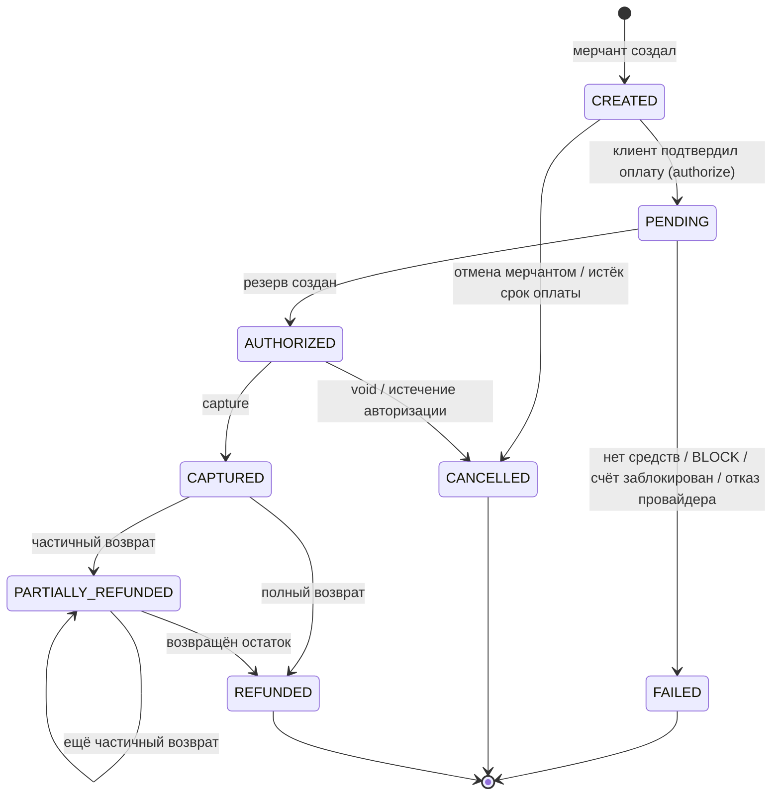
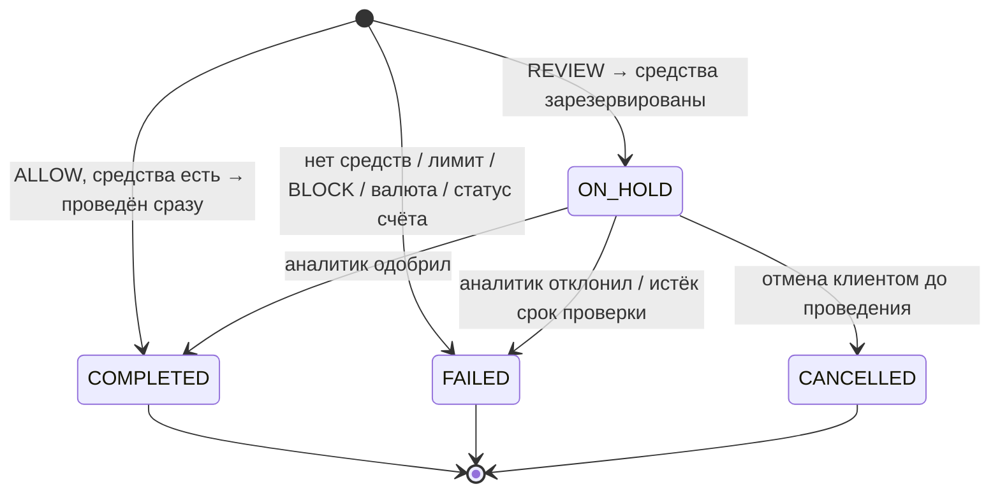
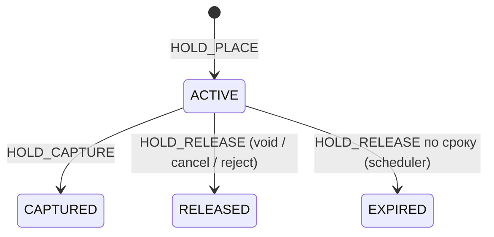
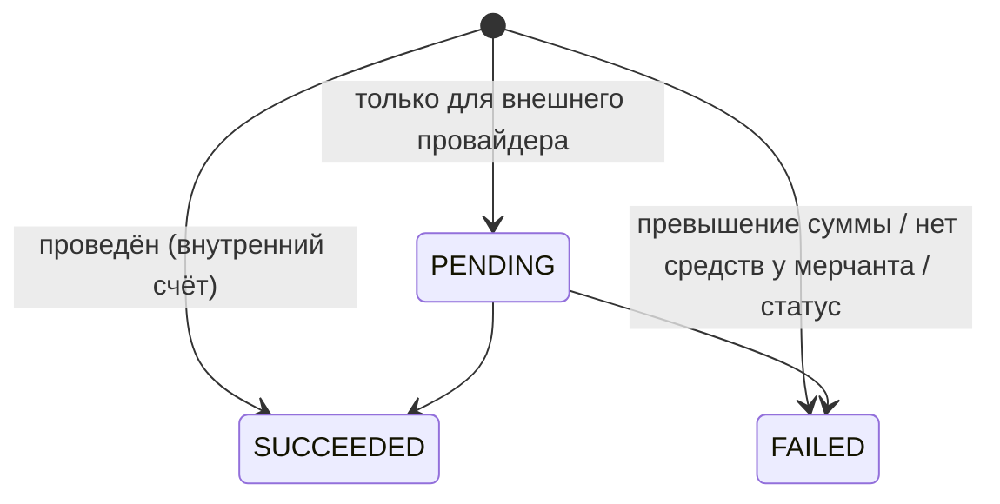

# Движение денег: проводки по шагам

Статус: **проект**. Счета — из [chart-of-accounts.md](chart-of-accounts.md), правила — из [ledger-model.md](ledger-model.md). Транзакционные шаблоны и блокировки для каждого сценария — в [../database/concurrency.md](../database/concurrency.md).

## 1. Обозначения и общие правила

- Суммы указаны в **копейках** (RUB, `minor_units = 2`); в скобках — рубли.
- `Дт X / Кт Y N` — дебет счёта X, кредит счёта Y на сумму N.
- Участники примеров:
  - **A1** — счёт клиента Ивана (RUB), ledger-счета `A1:2100` (доступно) и `A1:2110` (резерв);
  - **A2** — счёт клиента Марии (RUB);
  - **A1s** — второй счёт Ивана («Накопительный», RUB);
  - **MA** — счёт мерчанта «Shop» (RUB), `MA:2200`, `MA:2210`;
  - системные: `1100:RUB`, `4100:RUB`, `4200:RUB`.
- Тарифы из ТЗ §2.7: переводы 50 bp, платежи 150 bp, min 1 000 (10 ₽), max 50 000 (500 ₽), округление `HALF_UP` ([D-17](open-questions.md#d-17)).
- **Каждый шаг, отмеченный «ТХ», — одна транзакция PostgreSQL.** В неё входят журнал, проводки, проекция, статус бизнес-объекта, история статусов, outbox-событие и запись ключа идемпотентности.
- **Неуспешная операция не создаёт проводок.** Исключение: она освобождает ранее созданный резерв (`HOLD_RELEASE`). Отказ сохраняется как бизнес-объект со статусом `FAILED` и кодом причины ([D-19](open-questions.md#d-19)): это нужно для аудита и фрод-правила «несколько неудачных попыток подряд».

## 2. Машины состояний

Переходы в ТЗ не определены (диаграмма утеряна, [C-02](spec-analysis.md#1-противоречия-и-неоднозначности)). Ниже — предложение для согласования ([Q-02](open-questions.md#q-02)).

### 2.1. Платёж

- `PENDING` хранится в БД, только если решение откладывается: фрод-проверка вернула `REVIEW` или выполняется вызов внешнего провайдера. Для внутреннего платежа с `ALLOW` переход `CREATED → PENDING → AUTHORIZED` происходит в одной транзакции, обе смены статуса пишутся в `payment_status_history`.
- Запрещённые переходы (примеры из ТЗ §2.4): возврат из `CREATED`/`AUTHORIZED`/`FAILED`/`CANCELLED`; capture из `CAPTURED`; void из `CAPTURED` (после capture — только возврат).
- Отдельного статуса `EXPIRED` в ТЗ нет. Истечение авторизации — это `CANCELLED` с `cancel_reason = AUTH_EXPIRED` ([Q-05](open-questions.md#q-05)).

### 2.2. Перевод

Отмена возможна только из `ON_HOLD`: «до момента проведения» по ТЗ §2.5 ([D-05](open-questions.md#d-05)). Если в ТЗ подразумевались отложенные переводы по расписанию — это [Q-16](open-questions.md#q-16).

### 2.3. Резерв (hold)

### 2.4. Возврат

---

## 3. Пополнение счёта (предпосылка)

В ТЗ нет описания пополнения ([M-01](spec-analysis.md#2-недостающие-требования), [Q-04](open-questions.md#q-04)). Предложение ([D-15](open-questions.md#d-15), вариант A): деньги «приходят» из симулированного банка-партнёра.

**Иван пополняет A1 на 10 000 ₽.** ТХ:

| Счёт | Дебет | Кредит |
|---|---|---|
| 1100:RUB Банк-партнёр | 1 000 000 | |
| A1:2100 Клиент доступно | | 1 000 000 |
| **Итого** | **1 000 000** | **1 000 000** |

Операция `TOPUP`. После неё у A1: available = 1 000 000, reserved = 0. Кто может инициировать пополнение (клиент из UI «тестовыми деньгами» или только администратор/скрипт) — [Q-04](open-questions.md#q-04).

---

## 4. Переводы

Общие проверки перед проведением (в одной ТХ, под блокировкой, см. [concurrency.md §5.1](../database/concurrency.md#51-перевод)):

1. Ключ идемпотентности.
2. Счета существуют, отправитель принадлежит инициатору (ТЗ §5).
3. Статусы счетов разрешают дебет у отправителя и кредит у получателя ([Q-14](open-questions.md#q-14)).
4. Валюты обоих счетов совпадают с валютой перевода (FX вне скоупа).
5. `sender ≠ receiver`, `amount > 0`, `amount ≤ MAX`.
6. Лимиты ([Q-12](open-questions.md#q-12)).
7. Фрод-решение: `ALLOW` / `REVIEW` / `BLOCK`.
8. Расчёт комиссии.
9. Доступный остаток ≥ `amount + fee`.

### 4.1. Перевод между своими счетами

**Иван переводит 1 000 ₽ с A1 на A1s.** Комиссия по умолчанию 0 ([Q-09](open-questions.md#q-09)). ТХ, операция `TRANSFER`:

| Счёт | Дебет | Кредит |
|---|---|---|
| A1:2100 | 100 000 | |
| A1s:2100 | | 100 000 |
| **Итого** | **100 000** | **100 000** |

Если для переводов между своими счетами тариф ненулевой, схема та же, что в §4.2.

### 4.2. Перевод другому пользователю с комиссией (ALLOW)

**Иван переводит Марии 1 000 ₽.** Комиссия: 0,5 % = 500 коп., что меньше минимума, поэтому **1 000 (10 ₽)**. Комиссию платит отправитель сверх суммы перевода (допущение A-04, [Q-09](open-questions.md#q-09)). Списание = 101 000. ТХ, операция `TRANSFER`:

| Счёт | Дебет | Кредит |
|---|---|---|
| A1:2100 Иван доступно | 101 000 | |
| A2:2100 Мария доступно | | 100 000 |
| 4100:RUB Доход переводы | | 1 000 |
| **Итого** | **101 000** | **101 000** |

Результат: перевод `COMPLETED`, `fee_amount = 1 000`, `fee_tariff_id` = версия тарифа. Outbox: `transfer.completed`.

Вариант «комиссия из суммы перевода»: Иван списывает 100 000, Мария получает 99 000, доход — 1 000.

### 4.3. Перевод с ручной проверкой (REVIEW)

**Иван переводит Марии 300 000 ₽ (30 000 000), фрод-движок вернул `REVIEW`.** Комиссия 0,5 % = 150 000 коп., что выше max, поэтому **50 000 (500 ₽)**. Списание = 30 050 000.

Шаг 1 — ТХ, `HOLD_PLACE`. Перевод → `ON_HOLD`, создаётся `holds` (ACTIVE) и `fraud_cases`:

| Счёт | Дебет | Кредит |
|---|---|---|
| A1:2100 | 30 050 000 | |
| A1:2110 | | 30 050 000 |

Шаг 2а — аналитик одобрил. ТХ, `HOLD_CAPTURE`. Hold → `CAPTURED`, перевод → `COMPLETED`:

| Счёт | Дебет | Кредит |
|---|---|---|
| A1:2110 | 30 050 000 | |
| A2:2100 | | 30 000 000 |
| 4100:RUB | | 50 000 |

Шаг 2б — клиент отменил (ТЗ §2.5) **или** аналитик отклонил. ТХ, `HOLD_RELEASE`. Hold → `RELEASED`, перевод → `CANCELLED` / `FAILED`:

| Счёт | Дебет | Кредит |
|---|---|---|
| A1:2110 | 30 050 000 | |
| A1:2100 | | 30 050 000 |

Если перевод `ON_HOLD` не разобран за отведённое время, его автоматически отклоняют (или одобряют) — [Q-16](open-questions.md#q-16). Тариф фиксируется на шаге 1 (снимок `fee_tariff_id`), чтобы смена тарифа во время проверки не изменила сумму, уже зарезервированную у клиента.

### 4.4. Отмена перевода

- Из `ON_HOLD` — §4.3, шаг 2б.
- Из `COMPLETED` — **невозможна** как отмена. Возможны только ручная корректировка (§13) или обратный перевод от получателя по его воле. Это открытый вопрос, если ТЗ подразумевает иное ([Q-16](open-questions.md#q-16)).

### 4.5. Неуспешные переводы

Проводок нет, перевод сохраняется со статусом `FAILED` и `failure_code`.

| Ситуация | failure_code | Где обнаружено |
|---|---|---|
| Иван: 10 000 ₽, перевод 12 000 ₽ | `INSUFFICIENT_FUNDS` | под блокировкой `account_balances` |
| Два параллельных перевода по 8 000 ₽ при балансе 10 000 ₽ | второй — `INSUFFICIENT_FUNDS` | [concurrency.md, сценарий S-01](../database/concurrency.md#9-каталог-конкурентных-сценариев) |
| Счёт отправителя или получателя заблокирован | `ACCOUNT_BLOCKED` | под `FOR SHARE` на `accounts` |
| Разные валюты | `CURRENCY_MISMATCH` | валидация |
| Превышен лимит | `LIMIT_EXCEEDED` | Limits |
| Фрод `BLOCK` | `FRAUD_BLOCKED` | Fraud Engine; создаётся `fraud_cases` |
| Получатель не найден | — | 404/422 до создания перевода, перевод не сохраняется |

Рекомендация ([D-19](open-questions.md#d-19)): отказы по бизнес-правилам сохраняются. Ошибки валидации запроса (неверный JSON, отрицательная сумма) не сохраняются.

---

## 5. Платёж: создание → авторизация → подтверждение

**Иван платит мерчанту Shop 5 000 ₽ (500 000).** Комиссия 1,5 % = **7 500 (75 ₽)** удерживается с мерчанта (допущение A-04, [D-08](open-questions.md#d-08)).

**Шаг 1 — создание** (мерчант, API-ключ, `Idempotency-Key`). ТХ: `payments` (CREATED), outbox `payment.created`. **Проводок нет.** Клиентский счёт ещё не указан ([Q-01](open-questions.md#q-01)).

**Шаг 2 — авторизация** (клиент указывает A1). ТХ: проверки (как в §4: статус, валюта, фрод, остаток), затем `HOLD_PLACE`. Платёж `CREATED → PENDING → AUTHORIZED`, hold — `ACTIVE`, `expires_at = now + TTL` ([Q-05](open-questions.md#q-05)):

| Счёт | Дебет | Кредит |
|---|---|---|
| A1:2100 Иван доступно | 500 000 | |
| A1:2110 Иван резерв | | 500 000 |

Состояние A1: available = 500 000, reserved = 500 000. Это ровно пример ТЗ §2.2, где часть средств видна как «зарезервировано».

**Шаг 3 — подтверждение (capture)** (мерчант). ТХ: платёж `AUTHORIZED → CAPTURED`, `captured_amount = 500 000`, `fee_amount = 7 500`, hold → `CAPTURED`. Операция `HOLD_CAPTURE`:

| Счёт | Дебет | Кредит |
|---|---|---|
| A1:2110 Иван резерв | 500 000 | |
| MA:2200 Мерчант доступно | | 492 500 |
| 4200:RUB Доход платежи | | 7 500 |
| **Итого** | **500 000** | **500 000** |

Когда рассчитывать комиссию: при capture по тарифу на момент capture или фиксировать при авторизации — [Q-09](open-questions.md#q-09). Рекомендация: фиксировать при **авторизации**, как и для переводов, чтобы мерчант видел итог заранее.

Зачисление мерчанту сразу на «доступно» — упрощение MVP. Если нужна задержка расчётов (T+1, settlement), добавляется счёт «Мерчант — в расчёте» и отдельная операция `SETTLE` ([Q-07](open-questions.md#q-07)).

## 6. Отмена авторизации (void)

**Мерчант отменяет авторизованный платёж** (`POST /payments/{id}/cancel`). ТХ, `HOLD_RELEASE`: платёж `AUTHORIZED → CANCELLED`, hold → `RELEASED`.

| Счёт | Дебет | Кредит |
|---|---|---|
| A1:2110 | 500 000 | |
| A1:2100 | | 500 000 |

Отмена из `CREATED` — без проводок (резерва ещё нет). Отмена из `CAPTURED` запрещена — нужен возврат. Может ли клиент отменить авторизацию сам — [Q-02](open-questions.md#q-02).

## 7. Неуспешная авторизация

Проводок нет. Платёж `PENDING → FAILED` с `failure_code` (`INSUFFICIENT_FUNDS`, `ACCOUNT_BLOCKED`, `FRAUD_BLOCKED`, `CURRENCY_MISMATCH`, `PROVIDER_DECLINED`). В `payment_attempts` записывается попытка (ТЗ §2.4 «история попыток обработки»).

Можно ли повторить авторизацию после `FAILED` (например, после пополнения) или нужен новый платёж? Рекомендация: `FAILED` — финальный статус, мерчант создаёт новый платёж. Альтернатива — `FAILED → PENDING` с новой попыткой ([Q-02](open-questions.md#q-02)).

## 8. Неуспешное подтверждение

- Для внутреннего платежа capture может «не пройти» только по технической причине (откат ТХ). Тогда состояние не меняется (`AUTHORIZED`), и capture можно повторить идемпотентно.
- Повторный capture уже подтверждённого платежа возвращает идемпотентный ответ (с тем же ключом) или `409 INVALID_STATE` (с другим ключом). Второго журнала нет: `UNIQUE (reference_type, reference_id, operation)`.
- Capture после истечения авторизации → `409 AUTH_EXPIRED`.

## 9. Истечение авторизации

Scheduler периодически выбирает `holds` со статусом `ACTIVE` и `expires_at < now()` (`FOR UPDATE SKIP LOCKED`). Для каждого — ТХ, `HOLD_RELEASE`: hold → `EXPIRED`, платёж → `CANCELLED (AUTH_EXPIRED)`. Проводки — как в §6. Гонка «истечение против capture» разобрана в [concurrency.md, S-05](../database/concurrency.md#9-каталог-конкурентных-сценариев).

## 10. Возвраты

Общие правила:

- Возврат только из `CAPTURED` или `PARTIALLY_REFUNDED`.
- Под блокировкой строки платежа: `refunded_amount + amount ≤ captured_amount` (ТЗ §4.5). Дополнительно `CHECK (refunded_amount <= captured_amount)` в БД.
- Деньги возвращаются на исходный счёт клиента (A1). Что делать, если A1 заблокирован или закрыт — [Q-14](open-questions.md#q-14).
- Каждый возврат — отдельная строка `refunds` с собственным id и idempotency key, операция `REFUND`, `reference_id = refund.id`.

### 10.1. Полный возврат (комиссия не возвращается — D-09, вариант A, рекомендация)

**Мерчант возвращает 5 000 ₽.** ТХ: refund `SUCCEEDED`, платёж → `REFUNDED`, `refunded_amount = 500 000`.

| Счёт | Дебет | Кредит |
|---|---|---|
| MA:2200 Мерчант доступно | 500 000 | |
| A1:2100 Иван доступно | | 500 000 |

Важно: после capture мерчант получил 492 500, а возвращает 500 000. Если у мерчанта нет других средств, возврат упирается в недостаток средств (§10.4). Это прямое следствие политики «комиссия не возвращается».

### 10.2. Частичные возвраты

**Возврат 2 000 ₽, затем 3 000 ₽, затем попытка 1 ₽.**

| Шаг | Проверка | Проводки | Статус платежа | refunded_amount |
|---|---|---|---|---|
| Возврат R1 = 200 000 | 0 + 200 000 ≤ 500 000 ✓ | Дт MA:2200 / Кт A1:2100 200 000 | PARTIALLY_REFUNDED | 200 000 |
| Возврат R2 = 300 000 | 200 000 + 300 000 ≤ 500 000 ✓ | Дт MA:2200 / Кт A1:2100 300 000 | REFUNDED | 500 000 |
| Возврат R3 = 100 | платёж `REFUNDED` ✗ | нет | REFUNDED | 500 000; R3 — `FAILED (REFUND_EXCEEDS_CAPTURED)` или 409 без сохранения |

Возврат большей суммы, чем оплата (ТЗ §10): R = 600 000 при `captured = 500 000` → отказ, проводок нет.

### 10.3. Вариант: комиссия возвращается пропорционально (D-09, вариант B)

Возврат R1 = 200 000 из 500 000. Пропорциональная комиссия = `7 500 × 200 000 / 500 000` = 3 000 (округление по тому же правилу). Последний возврат забирает **остаток** комиссии, а не пропорцию: так сумма возвращённых комиссий в точности равна исходной.

| Счёт | Дебет | Кредит |
|---|---|---|
| MA:2200 Мерчант | 197 000 | |
| 4900:RUB Возвращённые комиссии | 3 000 | |
| A1:2100 Иван | | 200 000 |

Требует поля `payments.refunded_fee_amount` и `CHECK (refunded_fee_amount <= fee_amount)`.

### 10.4. Недостаточно средств у мерчанта (D-10)

- Вариант A (рекомендация для MVP): возврат `FAILED (MERCHANT_INSUFFICIENT_FUNDS)`, проводок нет. Мерчант должен пополнить счёт или дождаться поступлений.
- Вариант B: возврат проводится, разница уходит в задолженность мерчанта (Дт 1300 / Кт A1:2100 на недостающую часть). Её погашают будущие поступления.
- Вариант C: rolling reserve. Часть выручки держится на `MA:2210` под возвраты.

---

## 11. Комиссии — сводка

| Операция | Кто платит | Когда фиксируется | Когда признаётся доход | Счёт дохода |
|---|---|---|---|---|
| Перевод | Отправитель, сверх суммы | При создании перевода | В журнале `TRANSFER` / `HOLD_CAPTURE` | 4100 |
| Платёж | Мерчант, удержание из суммы | При авторизации (рекомендация) | В журнале `HOLD_CAPTURE` | 4200 |
| Возврат | Не взимается; комиссия платежа не возвращается (D-09 A) | — | — | — (4900 в варианте B) |
| Выплата мерчанту | [Q-07](open-questions.md#q-07) | — | — | — |

Комиссия **никогда** не списывается отдельным журналом после основной операции. Она входит в тот же журнал, иначе возможно состояние «перевод проведён, комиссия — нет».

## 12. Выплата мерчанту (payout)

ТЗ упоминает «Выплаты» без модели ([M-02](spec-analysis.md#2-недостающие-требования)). Предложение, трёхшаговое как для асинхронного внешнего банка:

| Шаг | Операция | Проводки (выплата 292 500) |
|---|---|---|
| Инициация | `PAYOUT_INIT` | Дт MA:2200 / Кт MA:2210 292 500 (резерв под выплату) |
| Отправлено в банк | `PAYOUT_SETTLE` | Дт MA:2210 / Кт 1100:RUB 292 500 |
| Отказ банка | `PAYOUT_FAIL` | Дт MA:2210 / Кт MA:2200 292 500 |

Если выплата синхронная (симулятор отвечает сразу), остаётся один журнал: Дт MA:2200 / Кт 1100. Счёт 2300 нужен, если между «списали у мерчанта» и «банк подтвердил» есть отдельное состояние без резерва мерчанта. Выбор схемы — [Q-07](open-questions.md#q-07).

## 13. Исправление ошибок: сторно и корректировка

**Сторно.** Ошибочно проведённый журнал J (например, пополнение 1 000 000 на счёт A2 вместо A1) исправляется двумя журналами:

1. `REVERSAL` J: Дт A2:2100 / Кт 1100 1 000 000, `reverses_journal_id = J`. Если на A2 уже нет 1 000 000, сторно упирается в `CHECK >= 0`, и требуется решение оператора ([Q-15](open-questions.md#q-15)).
2. Правильный `TOPUP`: Дт 1100 / Кт A1:2100 1 000 000.

**Корректировка.** Компенсация клиенту за сбой: заявка `manual_adjustments` (создал OPERATOR-1, утвердил ADMIN-2) → журнал `ADJUSTMENT`: Дт 5900 / Кт A1:2100. Каждое действие пишется в `audit_logs`.

## 14. Вариант: оплата через внешнего провайдера

Применимо, если [Q-03](open-questions.md#q-03) подтвердит карточные платежи через симулятор.

| Шаг | Ledger |
|---|---|
| Авторизация у провайдера | Проводок нет: средства резервирует банк клиента, а не PayCore. Фиксируется `payment_attempts`. |
| Capture у провайдера | `PROVIDER_CAPTURE`: Дт 1200 Провайдер 500 000 / Кт MA:2200 492 500 / Кт 4200 7 500 |
| Провайдер перечислил деньги | `PROVIDER_SETTLE`: Дт 1100 Банк / Кт 1200 Провайдер (с Дт 5100, если провайдер удержал комиссию) |
| Сверка | Строки реестра провайдера сопоставляются с движениями по 1200. Остаток 1200 сверх ожидаемого или с истёкшим сроком — расхождение → `reconciliation_items` → инцидент. |
| Возврат через провайдера | Дт MA:2200 / Кт 1200 (требование к провайдеру уменьшается) |

## 15. Сводная таблица

| Сценарий | Журналы | Состояние бизнес-объекта |
|---|---|---|
| Пополнение | TOPUP | topup COMPLETED |
| Перевод ALLOW | TRANSFER | COMPLETED |
| Перевод REVIEW → одобрен | HOLD_PLACE, HOLD_CAPTURE | ON_HOLD → COMPLETED |
| Перевод REVIEW → отменён/отклонён | HOLD_PLACE, HOLD_RELEASE | ON_HOLD → CANCELLED / FAILED |
| Перевод отклонён сразу | — | FAILED |
| Платёж создан | — | CREATED |
| Авторизация | HOLD_PLACE | AUTHORIZED |
| Авторизация отклонена | — | FAILED |
| Capture | HOLD_CAPTURE | CAPTURED |
| Void / истечение | HOLD_RELEASE | CANCELLED |
| Частичный возврат | REFUND | PARTIALLY_REFUNDED |
| Полный / последний возврат | REFUND | REFUNDED |
| Возврат отклонён | — | refund FAILED, платёж без изменений |
| Исправление ошибки | REVERSAL (+ новый журнал) / ADJUSTMENT | — |
