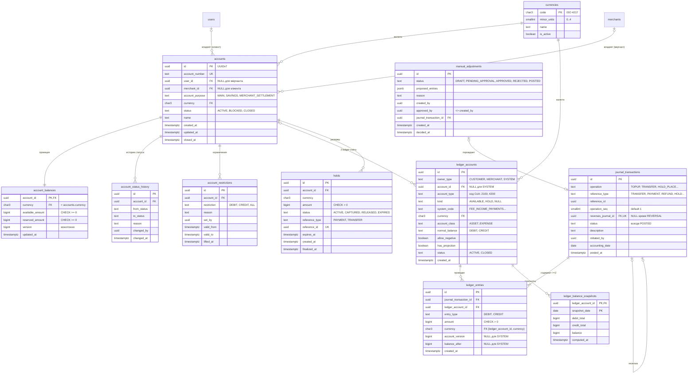
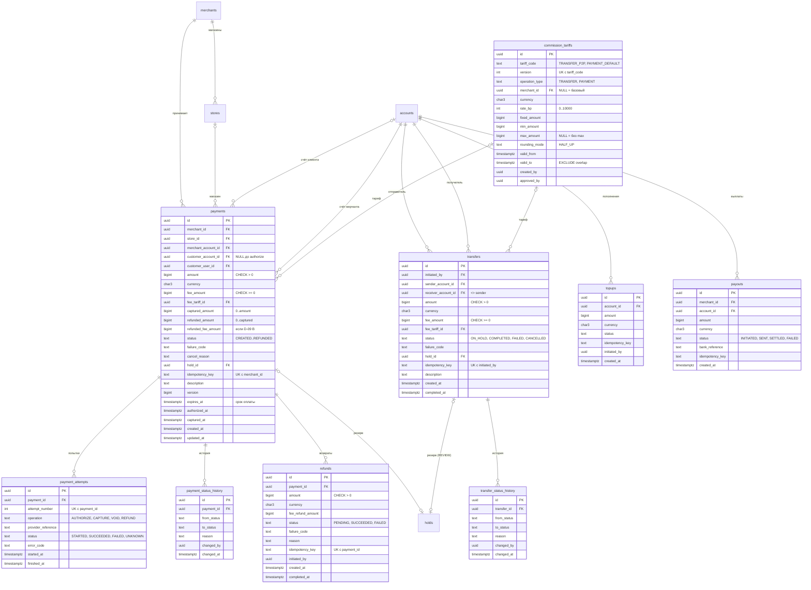
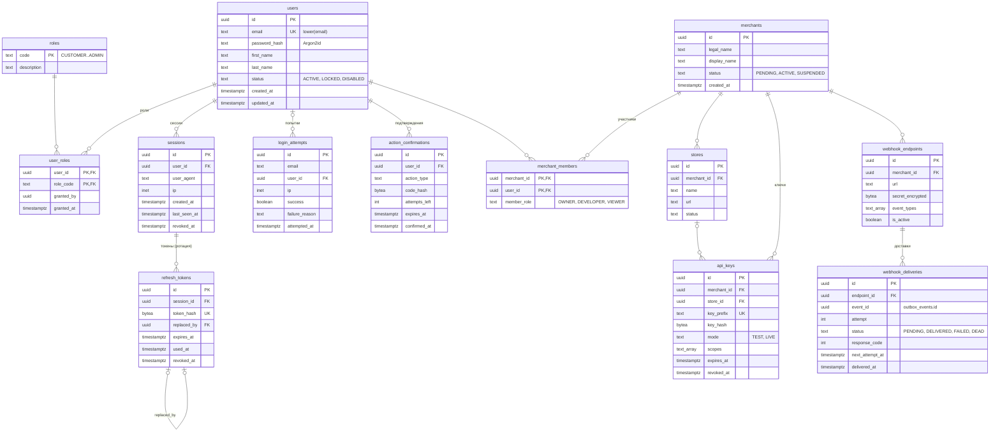
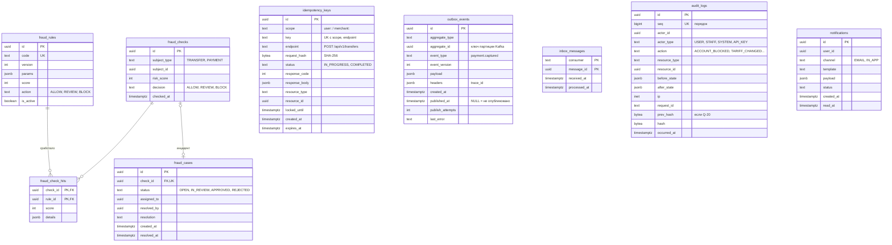
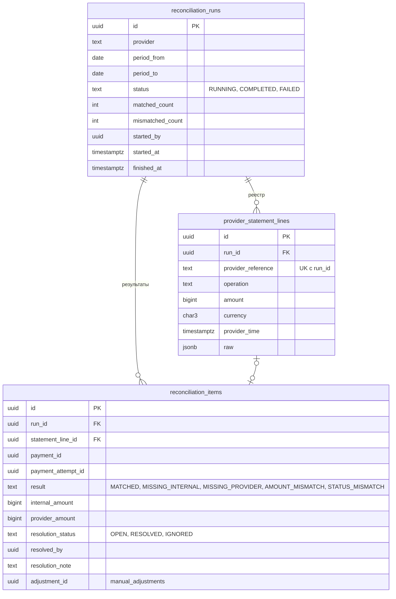

# ER-диаграмма PostgreSQL

Статус: **проект**. Описание полей и типов — в [database-schema.md](database-schema.md), ограничения и индексы — в [data-integrity.md](data-integrity.md).

Диаграмма разбита на пять частей по модулям. Таблицы, которые встречаются в нескольких частях, на последующих диаграммах показаны только ключевыми полями. Обозначения: `PK` — первичный ключ, `FK` — внешний ключ, `UK` — уникальный. Типы упрощены для Mermaid: `char3` = `CHAR(3)`, `text_array` = `TEXT[]`, `text` = `TEXT` с CHECK на перечень значений.

Схемы PostgreSQL (namespaces) по модулям ([D-18](../architecture/open-questions.md#d-18)): `auth`, `merchants`, `accounts`, `ledger`, `payments`, `transfers`, `commissions`, `fraud`, `reconciliation`, `notifications`, `audit`, `platform` (idempotency, outbox, inbox).

## 1. Финансовое ядро: счета и ledger

## 2. Платежи, переводы, комиссии

## 3. Идентификация и мерчанты

## 4. Надёжность, аудит, фрод

## 5. Сверка (Reconciliation)

## 6. Межмодульные связи

Полиморфные ссылки (без FK) — сознательное решение, рассчитанное на будущее разделение на сервисы ([D-12](../architecture/open-questions.md#d-12)):

| Откуда | Куда | Почему без FK |
|---|---|---|
| `journal_transactions.reference_id` | transfers / payments / refunds / holds / topups / payouts / manual_adjustments | Ledger не зависит от бизнес-модулей; целостность — `UNIQUE` + инвариант I-10 |
| `holds.reference_id` | payments / transfers | то же |
| `outbox_events.aggregate_id` | любой агрегат | инфраструктурная таблица |
| `audit_logs.resource_id` | любой ресурс | аудит переживает удаление и архивирование ресурсов |
| `fraud_checks.subject_id` | transfers / payments | Fraud будет выделен в сервис первым (ТЗ §3.3) |
| `reconciliation_items.payment_id` | payments | слабая связь; совпадение может не найтись |

FK внутри монолита, которые **разрешены** и будут удалены при выделении сервисов: `ledger_accounts.account_id → accounts`, `payments.*_account_id → accounts`, `transfers.*_account_id → accounts`, `accounts.user_id → users`, `accounts.merchant_id → merchants`.
